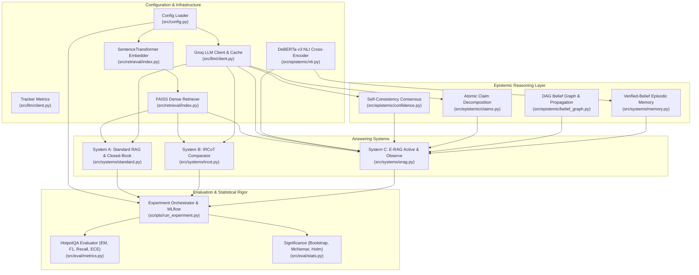

# Architecture Map & Component Dependency Blueprint (Phase 0 Audit)

**Date:** 2026-11-07  
**Auditor:** Senior AI Research Engineer & RAG Architect  
**Specification Reference:** *E-RAG Implementation Guide: End to End*, pp. 1–55

---

## 1. System Architecture Overview

The E-RAG research codebase comprises three principal QA architectures evaluated under identical corpus representations and generation constraints:

1. **System A — Standard RAG Baseline (`src/systems/standard.py`):** Single-pass dense retrieval ($k=3$) feeding an LLM generator with strict `"unknown"` instruction.
2. **System B — IRCoT-Inspired Comparator (`src/systems/ircot.py`):** Interleaved step-by-step Chain-of-Thought reasoning and iterative retrieval (up to 4 steps, pool cap 12).
3. **System C — E-RAG Epistemic System (`src/systems/erag.py`):** 12-step epistemic cycle with self-consistency confidence, atomic claim DAG extraction, entity-grounded NLI verification, logit belief updates, weakest-link propagation, Fast Path, EIG query selection, and safe abstention.

---

## 2. Component Dependency Architecture

---

## 3. Sub-Component Mapping & Implementation Locations

### 3.1 LLM Client & Caching Layer
- **Source File:** [`src/llm/client.py`](file:///d:/erag/src/llm/client.py)
- **Primary Class:** `LLM`
- **Cache Mechanism:** SQLite database (`results/cache.sqlite`). Deterministic SHA-256 key accounts for `{ns, model, messages, temperature, max_tokens, reasoning_effort, sample_idx}`.
- **Retry Mechanism:** 4-attempt exponential backoff ($2\text{s}, 4\text{s}, 8\text{s}, \dots, 30\text{s}$) capturing transient API errors.
- **Instrumented Tracker:** `Tracker` tracking `llm_calls`, `in_tokens`, `out_tokens`, `latency`, `cache_hits`, `retrievals`, `probe_searches`, and `failures`.

### 3.2 Dense Retrieval & Corpus Representation
- **Source File:** [`src/retrieval/index.py`](file:///d:/erag/src/retrieval/index.py)
- **Primary Classes:** `Embedder`, `Retriever`, `RetrieverFactory`
- **Embedding Model:** `sentence-transformers/all-MiniLM-L6-v2` with $L_2$-normalized 384-dimensional vectors.
- **Index:** `faiss.IndexFlatIP` (exact inner-product equivalent to cosine similarity on normalized vectors).
- **Paragraph Construction:** Matches Phase 1 baseline verbatim: `f"{title}. " + " ".join(sentences)`.
- **Modes Supported:**
  - `distractor`: Per-question index built over the question's 10 candidate paragraphs.
  - `pooled`: Shared corpus index built over deduplicated paragraphs across the split.

### 3.3 Epistemic Self-Consistency Confidence
- **Source File:** [`src/epistemic/confidence.py`](file:///d:/erag/src/epistemic/confidence.py)
- **Function:** `self_consistency()`
- **Mechanism:** Samples $k=5$ completions at temperature $T=0.7$. Normalizes answers and computes consensus:
  - `conf_majority`: Frequency of the modal answer.
  - `conf_draft_agreement`: Frequency of samples matching the deterministic $T=0.0$ draft.

### 3.4 Atomic Claim Extraction & DAG Construction
- **Source File:** [`src/epistemic/claims.py`](file:///d:/erag/src/epistemic/claims.py)
- **Function:** `extract_claims()`, `_parse()`
- **Mechanism:** Prompts LLM for JSON containing up to $N=5$ self-contained factual claims with entity names and backward-only dependency indices (`depends_on`). Enforces DAG acyclicity by discarding forward edges ($d \ge \text{len}(\text{out})$).
- **Fallback:** If JSON parsing fails, defaults to a single claim: `"The answer to \"{question}\" is {answer}."` with `fallback=True`.

### 3.5 Cross-Encoder NLI Verification & Entity Grounding
- **Source File:** [`src/epistemic/nli.py`](file:///d:/erag/src/epistemic/nli.py)
- **Primary Class:** `NLI`
- **Model:** `cross-encoder/nli-deberta-v3-base` on CPU with dynamic label lookup via `model.config.id2label`.
- **Sliding Window:** 2-sentence windows ($w=2$) with prepended paragraph title.
- **Entity Grounding Filter (`_extract_subject_entities`):** Rejects spurious contradictions unless the evidence passage explicitly mentions the subject entity or title of the claim.

### 3.6 Belief Graph & Weakest-Link Propagation
- **Source File:** [`src/epistemic/belief_graph.py`](file:///d:/erag/src/epistemic/belief_graph.py)
- **Primary Class:** `BeliefGraph`
- **Update Rule (Logit Space):**
  $$z_i = \text{logit}(c_0) + w_s \sum_{(p, s) \in \text{sup}} s - w_c \sum_{(p, s) \in \text{con}} s$$
  $$\text{conf}_i = \sigma(\text{clip}(z_i, -6.0, 6.0))$$
- **Propagation Rule (Weakest-Link):**
  $$\text{eff}_i = \min\left(\text{conf}_i, \min_{j \in \text{parents}(i)} \text{eff}_j\right)$$

### 3.7 Verified-Belief Episodic Memory
- **Source File:** [`src/systems/memory.py`](file:///d:/erag/src/systems/memory.py)
- **Primary Class:** `BeliefMemory`
- **Read Gating:** Retrieves top-3 beliefs if vector cosine similarity $\ge \theta_{\text{mem}} = 0.75$.
- **Contradiction Override:** If fresh evidence contradicts a retrieved memory belief ($c \ge \theta_c$), the belief is immediately purged from the store.
- **Surprise-Gated Write:** Writes supported claims only when initial confidence $c_0 < \theta_{\text{surprise}} = 0.6$ or contradiction was detected. Unused beliefs undergo geometric decay ($0.98$).

