# Execution Flow & Step-by-Step Pipeline Specifications (Phase 0 Audit)

**Date:** 2026-11-07  
**Auditor:** Senior AI Research Engineer & RAG Architect  
**Specification Reference:** *E-RAG Implementation Guide: End to End*, §10–§12

---

## 1. End-to-End Execution Flow Diagram

```mermaid
flowchart TD
    START(["Input Question & Gold Answer"]) --> DISPATCH{"System Dispatcher<br/>(scripts/run_experiment.py)"}

    %% System A: Standard RAG
    subgraph Flow_Standard["System A: Standard RAG Pipeline (src/systems/standard.py)"]
        S1["1. Dense Retrieval (k=3)"] --> S2["2. Prompt Context Construction"]
        S2 --> S3["3. Deterministic Generation (T=0.0)"]
        S3 --> S4["4. Return Draft Answer"]
    end

    %% System B: IRCoT
    subgraph Flow_IRCoT["System B: IRCoT Iterative Pipeline (src/systems/ircot.py)"]
        I1["1. Initial Retrieval (k=3)"] --> I2["2. CoT Reasoning Step (next_step)"]
        I2 --> I3{"Stop Condition?<br/>'So the answer is:' or max_steps"}
        I3 -- No --> I4["3. Retrieve with Reasoning Sentence"]
        I4 --> I5["4. Deduplicate & Append to Pool (cap=12)"]
        I5 --> I2
        I3 -- Yes --> I6["5. Final Reader Completion (T=0.0)"]
    end

    %% System C: E-RAG
    subgraph Flow_ERAG["System C: E-RAG 12-Step Adaptive Loop (src/systems/erag.py)"]
        E1["1. Initial Retrieval (k=3) & Memory Read"] --> E2["2. Draft Answer Generation (T=0.0)"]
        E2 --> E3["3. Self-Consistency Confidence (k=5, T=0.7)"]
        E3 --> E4["4. Atomic Claim Decomposition (extract_claims)"]
        E4 --> E5["5. Cross-Encoder NLI Verification (DeBERTa-v3)"]
        E5 --> E6["6. Belief Graph Construction (BeliefGraph.add)"]
        E6 --> E7["7. Logit Update & Weakest-Link Propagation"]
        E7 --> E8{"Mode / Stopping Check"}

        E8 -- "Observe Mode (Gate G1)" --> E9["Return Original Baseline Draft<br/>(Log would_abstain)"]

        E8 -- "Active Mode" --> E10{"Fast Path Check<br/>min_eff >= theta_fast (0.8)"}
        E10 -- "All Claims Supported (Fast Path)" --> E11["Exit Retrieval Loop"]
        E10 -- "Gaps Identified" --> E12["8. EIG Query Generation & Selection (3 queries)"]
        E12 --> E13["9. Targeted Adaptive Retrieval"]
        E13 --> E14{"New Passages Found &<br/>hop < max_hops (2)?"}
        E14 -- Yes --> E15["Update Evidence Pool (cap=12)<br/>hop += 1"] --> E2
        E14 -- No --> E11

        E11 --> E16{"Post-Hop Resampling?<br/>(hop > 0)"}
        E16 -- Yes --> E17["Recalculate Self-Consistency & Graph"]
        E16 -- No --> E18["Final Answer Claim Evaluation"]
        E17 --> E18

        E18 --> E19{"Abstention Controller<br/>ans.eff < theta_abs (0.4)?"}
        E19 -- Yes --> E20["Safe Abstention: Return 'unknown'"]
        E19 -- No --> E21["Return Final Draft Answer"]
        E20 --> E22["Optional: Memory Write Gating"]
        E21 --> E22
    end

    DISPATCH --> Flow_Standard
    DISPATCH --> Flow_IRCoT
    DISPATCH --> Flow_ERAG
```

---

## 2. Pipeline Stage Details & Source Traces

### 2.1 System A: Standard RAG Baseline
- **Execution Function:** `run_standard()` in [`src/systems/standard.py#L7-L26`](file:///d:/erag/src/systems/standard.py#L7-L26)
- **Step 1 (Dense Retrieval):** `paras = retriever.search(item["question"], k=3)`. Increases `tracker.retrievals += 1`.
- **Step 2 (Context Formatting):** Calls `answer_messages(question, paras)` from [`src/llm/prompts.py`](file:///d:/erag/src/llm/prompts.py).
- **Step 3 (Reader Generation):** `llm.chat(msgs, tracker, temperature=0.0)`.
- **Step 4 (Output Contract):** Returns `{"answer": str, "pool_titles": list, "hops": 0}`.
- **Resource Consumption:** Strictly **1 LLM call** and **1 Retrieval call** per question.

### 2.2 System B: IRCoT Iterative Baseline
- **Execution Function:** `run_ircot()` in [`src/systems/ircot.py#L36-L79`](file:///d:/erag/src/systems/ircot.py#L36-L79)
- **Step 1 (Initial Search):** `pool = retriever.search(q, k=3)`.
- **Step 2 (Reasoning Loop):** Loops up to `max_steps=4`:
  - `next_step()` in [`src/systems/ircot.py#L14-L33`](file:///d:/erag/src/systems/ircot.py#L14-L33) prompts LLM with current reasoning trajectory and context block.
  - Generates single next sentence with `max_tokens=256, temperature=0.0`.
  - Termination condition: if sentence contains `"so the answer is"` or is empty, terminates the loop.
  - Step query retrieval: uses the generated reasoning sentence directly as search query: `retriever.search(s, k=3)`.
  - Evidence pooling: deduplicates against `seen` titles and caps pool to `pool_cap=12`.
- **Step 3 (Final Reader):** Calls `llm.chat(answer_messages(q, pool), tracker, temperature=0.0)`.
- **Resource Consumption:** **2 to 5 LLM calls** and **1 to 4 Retrieval calls** per question (average on Test-400: $2.51$ LLM calls, $1.57$ retrievals).

### 2.3 System C: E-RAG Observational Mode (Gate G1)
- **Execution Function:** `run_erag()` with `erag.mode=observe` in [`src/systems/erag.py#L95-L215`](file:///d:/erag/src/systems/erag.py#L95-L215)
- **Execution Cycle:**
  1. Retrieves initial context ($k=3$).
  2. Generates initial draft with `temperature=0.0`.
  3. Samples $k=5$ completions at $T=0.7$ for epistemic confidence.
  4. Decomposes draft into atomic claims.
  5. Computes NLI entailment and contradiction scores across all passage windows.
  6. Constructs belief graph and propagates confidence.
  7. Identifies gaps and calculates `would_abstain`.
  8. Immediately breaks retrieval loop (`if not active: break`).
  9. **Critical Equivalence Guarantee:** Always returns `draft` verbatim. Never returns `"unknown"` or alters retrieved context.
- **Resource Consumption:** Exactly **7 LLM calls** (1 draft + 5 self-consistency + 1 claim extraction) and **1 Retrieval call**.

### 2.4 System C: E-RAG Active Mode (12-Step Adaptive Loop)
- **Execution Function:** `run_erag()` with `erag.mode=active` in [`src/systems/erag.py#L95-L215`](file:///d:/erag/src/systems/erag.py#L95-L215)
- **Step 1 (Initial Context & Memory):** `retriever.search(q, k=3)`. Reads memory if enabled.
- **Step 2 (Draft Generation):** `llm.chat(answer_messages(q, pool), tracker, temperature=0.0)`.
- **Step 3 (Confidence Estimation):** If `c0 is None`, runs `self_consistency(k=5, T=0.7)`.
- **Step 4 (Claim Extraction):** Prompts LLM for JSON atomic claims with DAG dependencies (`max_claims=5`).
- **Step 5 (NLI Verification):** Computes cross-encoder entailment and entity-grounded contradiction against all pool passages.
- **Step 6 & 7 (Graph Update & Propagation):** Logit updates ($w_s=1.0, w_c=1.0$) followed by topological weakest-link propagation.
- **Step 8 (Fast Path Check):** If no claims have gaps (`eff < theta_gap=0.6` or unverified) and `min_eff >= theta_fast=0.8`, triggers Fast Path exit.
- **Step 9 (EIG Query Selection):** Selects weakest unresolved claim (`graph.weakest(gaps)`). Prompts LLM for 3 candidate search queries. Ranks each query by uncertainty reduction $\times$ novel passage ratio:
  $$\text{Score}(q) = (1.0 - \text{eff}_{\text{claim}}) \times \frac{|\text{novel passages}|}{|\text{retrieved passages}|}$$
- **Step 10 (Targeted Retrieval):** Executes search with top-scoring candidate query, appends non-duplicate passages to pool (capped at 12).
- **Step 11 (Loop Iteration):** Increments `hop += 1`. If `hop < max_hops=2` and new passages were added, regenerates draft and repeats verification.
- **Step 12 (Abstention Controller):** Evaluates answer-bearing claim's effective confidence:
  $$\text{abstain} = \mathbb{I}(\text{ans.eff} < \theta_{\text{abs}}=0.40)$$
  If `abstain` is True, returns `"unknown"`; otherwise returns `draft`.
- **Resource Consumption:**
  - 0 hops (Fast Path): **7 LLM calls**, **1 Retrieval**.
  - 1 hop: **15 LLM calls** (1 draft + 5 SC + 1 claims + 1 query gen + 1 draft + 1 claims + 5 post-hop SC), **2 Retrievals** (+3 probe searches).
  - 2 hops: **17 LLM calls**, **3 Retrievals** (+6 probe searches).
  - Empirical Mean on Test-400: **14.22 LLM calls**, **2.46 Retrievals**.

