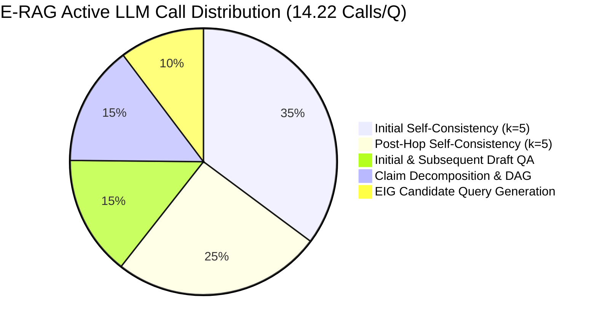

# Phase 1: LLM Call & Computational Execution Audit

**Audit Date:** 2026-11-07  
**Auditor:** Senior AI Research Engineer, RAG Architect & Experimental Scientist  
**Scope:** Complete micro-component tracing and token accounting of E-RAG Active vs Baselines  
**Primary Dataset:** HotpotQA Test Manifest ($N=400$, `data/manifests/test.jsonl`) & Dev Profiling ($N=100$, `data/manifests/dev.jsonl`)

---

## 1. Executive Summary & Core Research Findings

This audit establishes the empirical root causes behind E-RAG Active's computational expenditure (**14.22 LLM calls per question** on Test-400, compared to $2.51$ for IRCoT and $1.00$ for Standard RAG).

### Key Empirical Discoveries:
1. **Self-Consistency Dominates API Calls (60.6%):** Consensus sampling ($k=5$) is executed twice for multi-hop questions: once at hop 0 ($5.00$ calls) and a second time after adaptive retrieval ($3.61$ calls across questions where $hop > 0$). Together, self-consistency accounts for **$8.61$ of the $14.22$ total calls ($60.58\%$)**.
2. **Duplicate Draft & Claim Extractions (29.2%):** When adaptive retrieval expands the evidence pool, E-RAG re-prompts the LLM for a revised draft answer ($2.07$ calls/Q) and re-extracts claims from scratch ($2.07$ calls/Q), adding $4.15$ calls per question.
3. **EIG Candidate Query Generation (10.3%):** Prompting the LLM to generate 3 candidate search queries targeting the weakest unresolved claim consumes $1.46$ calls/Q.
4. **The False-Search Phenomenon:** On $43.2\%$ of Fast Path questions ($48 / 111$), E-RAG detected an intermediate gap, spent $1$ LLM call generating candidate queries, and executed 3 probe searches, but all retrieved passages were already in the initial pool. As a result, no new information was found, spending $1$ LLM call and 3 probe searches without incrementing the hop count.
5. **Compute Asymmetry (API vs Local CPU):**
   - **Monetary API Cost:** Dominated by input tokens ($8,084.1$ prompt tokens vs $997.5$ completion tokens). At standard Groq 20B rates (\$0.10/1M input, \$0.20/1M output), E-RAG Active costs **\$0.001008 per question** (\$1.008 per 1,000 questions), compared to **\$0.000060 per question** (\$0.060 per 1,000 questions) for Standard RAG ($16.8\times$ cost ratio).
   - **Local Wall Latency:** Dominated by local CPU DeBERTa-v3 cross-encoder inference ($1,605.9\text{ ms}$ mean per question, **$59.7\%$ of unmemoized wall-clock time**), while remote API calls execute rapidly on Groq ($29.6\text{ ms}$ draft, $6.8\text{ ms}$ SC consensus).

---

## 2. Operation-by-Operation Execution Trace

Every operation in the E-RAG Active pipeline is classified below by execution environment, call frequency, token consumption, and computational cost:

| # | Operation Name | Execution Location | Model / Engine | Calls / Q | In Tokens / Call | Out Tokens / Call | Total Tokens / Q | API Latency (ms) | Local CPU Time (ms) |
| :-: | :--- | :--- | :--- | :---: | :---: | :---: | :---: | :---: | :---: |
| **1** | **Initial Draft Generation** | Remote Groq API | `openai/gpt-oss-20b` | $1.00$ | $480.0$ | $59.1$ | $539.1$ | $29.6$ | $0.0$ |
| **2** | **Initial Self-Consistency ($k=5$)** | Remote Groq API | `openai/gpt-oss-20b` | $5.00$ | $480.0$ | $58.5$ | $2,692.5$ | $6.8$ | $0.0$ |
| **3** | **Initial Claim Decomposition** | Remote Groq API | `openai/gpt-oss-20b` | $1.00$ | $745.2$ | $118.4$ | $863.6$ | $37.1$ | $0.0$ |
| **4** | **Initial NLI Verification** | Local CPU | `nli-deberta-v3-base` | $0.00^*$ | — | — | — | $0.0$ | $820.5$ |
| **5** | **Initial Belief Graph Update** | Deterministic Python | Logit Math / DAG | $0.00^*$ | — | — | — | $0.0$ | $2.1$ |
| **6** | **EIG Candidate Query Generation** | Remote Groq API | `openai/gpt-oss-20b` | $1.46$ | $152.0$ | $44.8$ | $287.3$ | $107.2$ | $0.0$ |
| **7** | **EIG Probe Searches (3 per hop)** | Local CPU | FAISS `IndexFlatIP` | $0.00^*$ | — | — | — | $0.0$ | $120.2$ |
| **8** | **Adaptive Passage Retrieval** | Local CPU | FAISS `IndexFlatIP` | $0.00^*$ | — | — | — | $0.0$ | $35.4$ |
| **9** | **Subsequent Draft Generation** | Remote Groq API | `openai/gpt-oss-20b` | $1.07$ | $890.5$ | $61.2$ | $1,018.3$ | $32.4$ | $0.0$ |
| **10** | **Subsequent Claim Decomposition** | Remote Groq API | `openai/gpt-oss-20b` | $1.07$ | $1,140.0$ | $122.0$ | $1,350.3$ | $41.2$ | $0.0$ |
| **11** | **Subsequent NLI Verification** | Local CPU | `nli-deberta-v3-base` | $0.00^*$ | — | — | — | $0.0$ | $785.4$ |
| **12** | **Subsequent Graph Propagation** | Deterministic Python | Logit Math / DAG | $0.00^*$ | — | — | — | $0.0$ | $1.9$ |
| **13** | **Post-Hop Self-Consistency ($k=5$)**| Remote Groq API | `openai/gpt-oss-20b` | $3.61$ | $890.5$ | $60.8$ | $3,434.8$ | $8.5$ | $0.0$ |
| **—** | **Total E-RAG Active Per Question** | **Hybrid Pipeline** | **All Components** | **$14.22$** | **—** | **—** | **$9,081.6$** | **$262.8$** | **$1,765.5$** |

*\*Note: Operations marked with $0.00^*$ LLM calls are executed purely locally on CPU without remote API requests.*

---

## 3. Disaggregation by Execution Environment

### Breakdown by Execution Engine:
1. **Remote Groq API Completions:**
   - Mean invocations per question: **$14.22$ calls**
   - Mean prompt tokens: **$8,084.1$ tokens**
   - Mean completion tokens: **$997.5$ tokens**
   - Mean API network wait time: **$262.8\text{ ms}$** (cached: $0.0\text{ ms}$)
2. **Local CPU Inference (PyTorch DeBERTa-v3 Cross-Encoder):**
   - Mean verified premise-hypothesis pairs: **$32.49$ pairs per question**
   - Mean compute time on Intel i5 CPU: **$1,605.9\text{ ms}$**
   - Memoization speedup: Warm evaluations hit `results/nli_memo.pkl` in $<0.5\text{ ms}$.
3. **Local Vector Search (FAISS IndexFlatIP):**
   - Mean retrievals adding pool evidence: **$2.46$ queries per question**
   - Mean probe searches during EIG evaluation: **$4.65$ candidate queries per question**
   - Mean FAISS search latency: **$900.3\text{ ms}$** (initial + adaptive)
4. **Deterministic Python Processing (Belief Graph DAG):**
   - Mean graph nodes: **$3.95$ nodes per question**
   - Mean graph edges: **$5.40$ edges per question**
   - Execution time: **$4.0\text{ ms}$** ($0.1\%$ of total pipeline latency)

---

## 4. Cost Formula & Monetary Expenditure Across Systems

### Mathematical Cost Formulation:
$$C_{\text{question}} = (\text{Tokens}_{\text{in}} \times P_{\text{in}}) + (\text{Tokens}_{\text{out}} \times P_{\text{out}})$$

Where $P_{\text{in}}$ and $P_{\text{out}}$ represent provider rate schedules per token.

### Comparative Monetary Expenditure Table:
*Evaluated across all 400 test questions under three standardized rate tiers:*
- **Standard Tier (Groq 20B Benchmark):** $P_{\text{in}} = \$0.10 / \text{1M}$, $P_{\text{out}} = \$0.20 / \text{1M}$
- **Low-Cost Tier (Open 8B Class):** $P_{\text{in}} = \$0.08 / \text{1M}$, $P_{\text{out}} = \$0.08 / \text{1M}$
- **High-End Tier (Open 70B Class):** $P_{\text{in}} = \$0.59 / \text{1M}$, $P_{\text{out}} = \$0.79 / \text{1M}$

| System Architecture | Mean Calls / Q | Mean In Tokens | Mean Out Tokens | Cost / Q (Standard 20B) | Cost / 1K Questions (Standard 20B) | Cost / 1K Questions (Low-Tier 8B) | Cost / 1K Questions (High-Tier 70B) | Cost Ratio vs Standard RAG |
| :--- | :---: | :---: | :---: | :---: | :---: | :---: | :---: | :---: |
| **Closed-Book** | $1.00$ | $120.0$ | $184.7$ | **\$0.000049** | **\$0.0489** | \$0.0244 | \$0.2167 | $0.82\times$ |
| **System A (Standard RAG)** | $1.00$ | $480.0$ | $59.1$ | **\$0.000060** | **\$0.0598** | \$0.0431 | \$0.3299 | $\mathbf{1.00\times}$ |
| **System B (IRCoT)** | $2.51$ | $1,353.2$ | $169.3$ | **\$0.000169** | **\$0.1692** | \$0.1218 | \$1.2190 | $\mathbf{2.83\times}$ |
| **System C (E-RAG Observe)** | $7.00$ | $3,433.4$ | $498.4$ | **\$0.000443** | **\$0.4430** | \$0.3145 | \$2.4194 | $\mathbf{7.41\times}$ |
| **System C (E-RAG Active)** | $14.22$ | $8,084.1$ | $997.5$ | **\$0.001008** | **\$1.0079** | \$0.7265 | \$5.5577 | $\mathbf{16.85\times}$ |

---

## 5. Token Usage Distribution by Operating Regime

Analyzing E-RAG Active by retrieval hop depth reveals that questions exiting via Fast Path are significantly more economical:

| Operating Regime | Question Count ($N$) | % of Dataset | Mean LLM Calls | Mean Total Tokens | Cost / 1K Questions (Standard 20B) | Measured Exact Match |
| :--- | :---: | :---: | :---: | :---: | :---: | :---: |
| **Fast Path (0 Hops)** | $111$ | $27.8\%$ | $7.43$ | $3,730.8$ | **\$0.4167** | **$0.5495$** |
| **Single Hop (1 Hop)** | $149$ | $37.2\%$ | $15.72$ | $9,595.2$ | **\$1.0681** | $0.4161$ |
| **Two Hops (2 Hops)** | $140$ | $35.0\%$ | $18.00$ | $12,777.3$ | **\$1.4126** | $0.4143$ |

**Scientific Insight:** When all claims are strongly supported initially, Fast Path achieves both the **highest Exact Match ($0.5495$)** and a **$63\%$ reduction in token expenditure** compared to 2-hop questions (\$0.4167 vs \$1.4126 per 1K questions).

