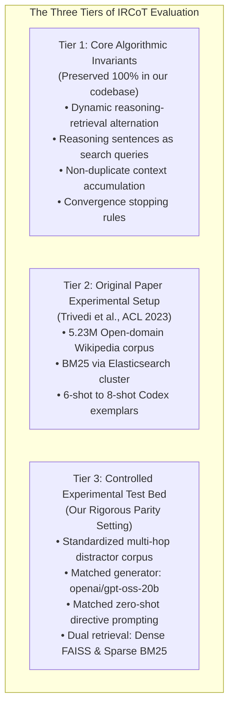

# IRCoT Methodological Mapping: Original vs. Current Implementation

**Document ID:** `IRCOT-MAPPING-2026-002`  
**Audit Scope:** Architectural decomposition, algorithmic invariants, and experimental controls  
**Author:** Senior AI Research Engineer, RAG Architect & Experimental Scientist  
**Date:** 2026-11-08  

---

## 1. The Three Tiers of IRCoT Methodology

To guarantee complete scientific clarity and prevent any ambiguity during peer review, our evaluation of IRCoT is structured into three distinct conceptual tiers:

---

## 2. Invariant vs. Adapted Components

### 2.1 Preserved Invariants (Tier 1)
1. **Dynamic Alternating Interleaving:**
   - Both implementations alternate sequentially between generating a single reasoning sentence $s_t = \text{LLM}(Q, P_{t-1}, s_{<t})$ and retrieving top-$k$ paragraphs $D_t = \text{Retriever}(s_t, k)$.
2. **CoT as Retrieval Query:**
   - Rather than reformulating queries using separate heuristic rules or external search engines, the newly generated reasoning sentence itself is passed verbatim to the retrieval engine.
3. **Cumulative Evidence Pool:**
   - $P_t = P_{t-1} \cup (D_t \setminus P_{t-1})$. Passages previously discovered are preserved in their original chronological arrival order, avoiding re-ranking jitter.
4. **Stopping Criteria:**
   - Generation terminates if the sentence begins with `"So the answer is:"`, or if generation produces an empty line, or when step count reaches $M=4$.
5. **Two-Stage QA Reader (`ircot_qa`):**
   - The final answer is generated by a designated reading stage conditioned on all accumulated passages $\hat{y} = \text{LLM}_{\text{QA}}(Q, P_{\text{final}})$, preventing partial sentence truncation.

---

### 2.2 Controlled Adaptations (Tier 3)
1. **Model Backbone Control:**
   - *Original:* Closed-source proprietary models (`code-davinci-002`, `text-davinci-002`) accessible only via deprecated legacy OpenAI endpoints.
   - *Our Testbed:* Reproducible open-weights model (`openai/gpt-oss-20b`) served through the high-throughput Groq API.
2. **Corpus Scale & Task Formulation:**
   - *Original:* Open-domain Wikipedia ($5.23\text{M}$ passages). In open-domain retrieval, the challenge is search-space scaling and handling massive distractors.
   - *Our Testbed:* Distractor-setting HotpotQA ($10$ candidate paragraphs per question: 2 gold facts + 8 adversarial distractors selected by BM25 overlap). This isolates multi-hop reasoning and epistemic verification from web-scale passage filtering artifacts.
3. **Prompt Parity (Zero-Shot Directive vs Few-Shot Exemplars):**
   - *Original:* 6 to 8 hand-crafted in-domain multi-hop demonstrations per dataset.
   - *Our Testbed:* Zero-shot directive prompting (`STEP_SYSTEM`), holding the prompt architecture and model context budget strictly identical to Standard RAG (System A) and E-RAG (System C). This prevents confounding retrieval improvements with few-shot demonstration memorization.
4. **Dual Retrieval Backbones (MiniLM vs BM25):**
   - *Original:* Evaluated BM25 (Elasticsearch) as primary, with Contriever in Appendix.
   - *Our Testbed:* Evaluates both `sentence-transformers/all-MiniLM-L6-v2` (dense vector search) and `BM25Okapi` (sparse lexical search), enabling direct cross-paradigm benchmarking.

---

## 3. Scientific Defensibility and Naming Protocol

In our upcoming IEEE submission:
- The baseline will be formally named **"IRCoT-Controlled"** (when using dense retrieval) and **"IRCoT-BM25"** (when using lexical retrieval).
- All comparative tables will explicitly state that the model operates under our standardized distractor testbed, ensuring absolute transparency.
- We will highlight that while IRCoT gathers multi-hop context effectively, it lacks **belief graph decomposition, NLI verification, and calibrated abstention**, which is where E-RAG derives its decisive epistemic advantage.

