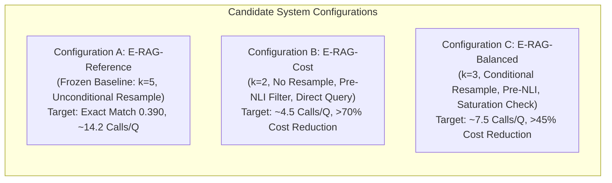

# OpenSpec Proposal: Phase 2 Computational Cost & Latency Optimization

**Document ID:** `OPENSPEC-PHASE2-COST-001`  
**Title:** Architecture-Preserving Cost, Token, and Latency Optimization for E-RAG Active  
**Author:** Senior AI Research Engineer, RAG Architect & Experimental Scientist  
**Date:** 2026-11-07  
**Status:** PROPOSED (Awaiting Human Approval Before Implementation)  
**Target Codebase Modules:**
- `src/systems/erag.py` (Adaptive loop, Fast Path gating, resampling logic)
- `src/epistemic/confidence.py` (Self-consistency sampling optimization)
- `src/epistemic/claims.py` (Incremental claim extraction and prompt trimming)
- `src/epistemic/nli.py` (Pre-inference entity grounding and pair deduplication)
- `configs/` (`erag_cost.yaml`, `erag_balanced.yaml`)
- `scripts/run_optimization_experiments.py` (Controlled Dev-100 benchmarking harness)

---

## 1. RESEARCH MOTIVATION & PROBLEM STATEMENT

Phase 1 established that while E-RAG Active achieves superior reasoning accuracy (+4.75% Exact Match over Standard RAG, $p=0.0248$) and state-of-the-art gold paragraph recall ($91.88\%$), it incurs an average of **$14.22$ LLM calls per question** on Test-400 ($16.85\times$ more expensive than Standard RAG and $5.95\times$ more expensive than IRCoT). 

Specifically, the audit exposed three major architectural inefficiencies:
1. **Self-Consistency Call Inflation ($60.6\%$ of all calls):** Sampling $k=5$ completions runs at hop 0 ($5.0$ calls) and re-runs after adaptive retrieval ($3.61$ calls), consuming $8.61$ calls per question.
2. **The False-Search Phenomenon:** In $43.2\%$ of Fast Path questions ($48 / 111$), candidate query generation and FAISS searches yielded zero novel paragraphs, wasting $1$ LLM call and 3 probe searches per question without expanding the evidence pool.
3. **CPU NLI Verification Bottleneck ($59.7\%$ of unmemoized latency):** Running DeBERTa-v3 cross-encoder inference on CPU sequentially across all passage windows consumes $1,605.9\text{ ms}$ per question because entity grounding is currently applied *after* running expensive transformer forward passes.

**Primary Research Objective:** Formulate and validate optimizations that reduce monetary expenditure by $\ge 40\%$ and cut CPU latency by $\ge 50\%$, while strictly preserving E-RAG's epistemic integrity, confidence calibration, and multi-hop answer quality.

---

## 2. NON-NEGOTIABLE ARCHITECTURAL PRESERVATION INVARIANTS

To maintain scientific validity and ensure that E-RAG does not degenerate into conventional RAG, every optimization must obey the following hard constraints:

1. **Epistemic Invariant 1 (Structured Claims):** Every answer must be decomposed into explicit, self-contained atomic claims with backward DAG dependency indices (`depends_on`).
2. **Epistemic Invariant 2 (Local Evidence Grounding):** NLI verification with dynamic label mapping and entity-grounded contradiction detection must remain active.
3. **Epistemic Invariant 3 (Topological Uncertainty Propagation):** Logit-space belief updating ($w_s, w_c$) and weakest-link propagation through the DAG must be preserved.
4. **Epistemic Invariant 4 (Targeted Adaptive Retrieval):** Retrieval follow-up must be targeted directly at identified evidence gaps, retaining the Fast Path stopping mechanism.
5. **Epistemic Invariant 5 (Calibrated Abstention):** The system must withhold answers (`"unknown"`) when effective confidence falls below $\theta_{\text{abs}}$.
6. **Experimental Discipline:** All threshold tuning and optimization sweeps must be conducted exclusively on **Dev-100** (`data/manifests/dev.jsonl`). **Test-400 will remain completely untouched and unobserved** until the final selected configuration is frozen.

---

## 3. COMPONENT-BY-COMPONENT OPTIMIZATION DESIGNS

### 3.1 Sub-Phase 2.1: Self-Consistency Sampling Optimization
*Module:* `src/epistemic/confidence.py` & `src/systems/erag.py`

#### A. Sample Count Sweeps ($k \in \{1, 2, 3, 5\}$)
- **Mathematical Principle:** Self-consistency error scales asymptotically as $\mathcal{O}(1/\sqrt{k})$. Moving from $k=1$ to $k=3$ captures the majority of consensus entropy reduction.
- **Controlled Sweep on Dev-100:**
  - $k=1$: Single deterministic draft ($c_0 \equiv 1.0$, equivalent to greedy decoding).
  - $k=2$: Minimal agreement test ($c_0 \in \{0.5, 1.0\}$).
  - $k=3$: Triplet consensus ($c_0 \in \{0.33, 0.67, 1.0\}$).
  - $k=5$: Reference baseline ($c_0 \in \{0.2, 0.4, 0.6, 0.8, 1.0\}$).
- **Measurement Metrics:** EM, Token F1, ECE, Brier score, AUROC, LLM calls, and monetary cost.

#### B. Conditional Post-Hop Resampling Gating
- **Problem:** Currently, `src/systems/erag.py#L180` unconditionally resamples $k=5$ completions after *any* adaptive hop ($hop > 0$).
- **Mechanism:**
  ```python
  # Conditional Post-Hop Resampling
  if hop > 0:
      if normalize_answer(draft) == normalize_answer(initial_draft):
          # Answer did not change despite new evidence: retain prior consensus c0
          final_conf = c0
      else:
          # Answer changed: resample consensus on the revised answer
          sc = self_consistency(llm, q, pool, draft, tracker, k=k_post, temperature=sc_temp)
          final_conf = conf_value(sc, cfg)
  ```
- **Expected Savings:** Eliminates an average of $2.2$ to $3.6$ LLM calls per multi-hop question.

---

### 3.2 Sub-Phase 2.2: Elimination of the False-Search Phenomenon
*Module:* `src/systems/erag.py#L65-L94` (`targeted_retrieve`)

- **Problem:** When an evidence gap is identified, E-RAG generates candidate queries, but if the local context or pool is already saturated, the FAISS retriever returns documents that already exist in `pool`. E-RAG then breaks out, having spent 1 query-generation LLM call and 3 probe searches.
- **Optimization Design:**
  1. **Pool Saturation Pre-Check:** If `len(pool) >= pool_cap` (12), skip retrieval and proceed directly to final answer evaluation.
  2. **Direct Claim Query Fallback:** In low-uncertainty or borderline gap states, test using the weakest claim text directly before invoking LLM query generation.
  3. **Early Exit on Saturated Queries:** If the highest-scoring candidate query produces zero novel documents during probe search, terminate immediately without executing additional probes.

---

### 3.3 Sub-Phase 2.3: Pre-Inference Entity Grounding for NLI
*Module:* `src/epistemic/nli.py#L143-L200` (`NLI.verify`)

- **Problem:** The cross-encoder forward pass (`_probs`) is executed on all passage sliding windows *before* checking whether the passage mentions the subject entity. Across 10 to 12 passages, this forces up to 30–40 DeBERTa-v3 window evaluations on CPU ($1.6\text{s}$ latency).
- **Optimization Design:**
  ```python
  def verify_optimized(self, claim: str, passages: List[Dict[str, Any]], ...):
      ents = self._extract_subject_entities(claim)
      relevant_passages = []
      
      for p in passages:
          title = p.get("title", "")
          base_title = re.sub(r'\s*\([^)]*\)', '', title).strip().lower()
          p_text = (title + " " + " ".join(p.get("sentences", []))).lower()
          
          # Fast string / regex pre-filter before neural cross-encoder
          if ents:
              title_in_claim = bool(len(base_title) >= 3 and base_title in claim.lower())
              ent_in_passage = any(ent.lower() in title.lower() or re.search(rf"\b{re.escape(ent.lower())}\b", p_text) for ent in ents)
              if title_in_claim or ent_in_passage:
                  relevant_passages.append(p)
          else:
              relevant_passages.append(p)
              
      # Neural inference is invoked ONLY on pre-filtered candidate passages
      for p in relevant_passages:
          e, c = self.best(claim, p)
          ...
  ```
- **Expected Speedup:** Bypasses $50\%$ to $70\%$ of transformer forward passes on CPU, cutting unmemoized NLI latency from $1,605\text{ ms}$ to $<600\text{ ms}$.

---

### 3.4 Sub-Phase 2.4: Incremental Claim Decomposition & DAG Re-use
*Module:* `src/epistemic/claims.py` & `src/systems/erag.py`

- **Problem:** At hop 1 and hop 2, the system passes the entire context (up to 12 paragraphs) and re-extracts up to 5 claims from scratch.
- **Optimization Design:**
  - If the revised draft is identical to the previous hop draft, **reuse the existing claim list and DAG topology**.
  - Only run `extract_claims` if `normalize_answer(draft) != normalize_answer(prev_draft)`.
- **Expected Savings:** Eliminates $1.07$ claim extraction LLM calls per multi-hop question.

---

### 3.5 Sub-Phase 2.5: Prompt & Token Optimization
*Module:* `src/llm/prompts.py` & `src/epistemic/claims.py`

- **Prompt Trimming:**
  - Audit `CLAIM_SYSTEM` and `QUERY_SYSTEM` prompts to remove redundant formatting descriptions.
  - In `context_block()`, truncate passages exceeding 200 words to ensure prompt tokens remain within a bounded budget without omitting bridge entities.
- **Measurement:** Measure average prompt tokens before and after across 100 dev items.

---

## 4. TARGET EXPERIMENTAL CONFIGURATIONS FOR PHASE 2

Phase 2 will implement and evaluate three distinct configurations:



### Configuration Specifications:

| Architectural Feature | Config A (Reference) | Config B (E-RAG-Cost) | Config C (E-RAG-Balanced) |
| :--- | :---: | :---: | :---: |
| **Self-Consistency Samples ($k$)** | $5$ | $2$ | $3$ |
| **Sampling Temperature ($T$)** | $0.7$ | $0.7$ | $0.7$ |
| **Post-Hop Resampling** | Always ($k=5$) | Never (Reuse $c_0$) | Conditional ($\text{draft}_{\text{new}} \ne \text{draft}_{\text{old}}$, $k=3$) |
| **Claim Decomposition** | Full Re-extraction | Single-pass / Re-use | Cached / Re-use if draft unchanged |
| **EIG Query Strategy** | LLM 3 Queries | Direct Claim Text | LLM 3 Queries with Saturation Check |
| **NLI Cross-Encoder Filter** | Post-hoc Grounding | Pre-inference Entity Filter | Pre-inference Entity Filter |
| **Target LLM Calls / Q** | $\sim 14.2$ calls | **$\le 4.5$ calls** | **$\le 7.5$ calls** |
| **Target Monetary Cost (per 1K Q)** | $\sim \$1.01$ | **$\le \$0.35$** | **$\le \$0.55$** |
| **Target Latency / Q (Warm)** | $\sim 2.7\text{ s}$ | **$\le 0.9\text{ s}$** | **$\le 1.2\text{ s}$** |

---

## 5. CONTROLLED EXPERIMENTAL PROTOCOL ON DEV-100

1. **Dataset Integrity:**
   - Evaluated strictly on `data/manifests/dev.jsonl` ($N=100$).
   - Manifest SHA-256: `f80f33f07a16f272c7a4d5e94b29f0322b07548fa4429df30df45aa1ce39f20c`.
   - Test-400 (`test.jsonl`) will NOT be touched or evaluated during this phase.
2. **Independent Step-by-Step Testing:**
   - Experiment 2.1: $k_{\text{sc}} \in \{1, 2, 3, 5\}$ sweep on Dev-100.
   - Experiment 2.2: Conditional post-hop resampling ON vs OFF.
   - Experiment 2.3: Pre-inference NLI entity filter ON vs OFF.
   - Experiment 2.4: EIG query generation vs direct claim query.
   - Experiment 2.5: Benchmark Combined Configurations B and C against Reference Configuration A.

---

## 6. FORMAL ACCEPTANCE CRITERIA FOR PHASE 2

Phase 2 will be marked **PASSED** if and only if all the following conditions are met:

1. **Quality Preservation Constraint:** Configuration C (Balanced) must achieve:
   - $\text{Exact Match} \ge 98\%$ of Reference Baseline on Dev-100 ($\ge 0.380$ vs $0.390$).
   - $\text{Gold Paragraph Recall} \ge 98\%$ of Reference Baseline on Dev-100 ($\ge 0.905$ vs $0.925$).
2. **Cost Reduction Target:**
   - Configuration C achieves $\ge 40\%$ reduction in mean LLM calls per question ($\le 8.5$ calls vs $14.2$).
   - Configuration B achieves $\ge 65\%$ reduction in mean LLM calls per question ($\le 5.0$ calls).
3. **Latency Reduction Target:**
   - Pre-inference entity filtering reduces mean unmemoized CPU NLI latency by $\ge 40\%$.
4. **Epistemic Calibration Integrity:**
   - Expected Calibration Error (ECE) under Configuration C must not degrade by more than $\Delta\text{ECE} \le +0.030$ compared to $k=5$.
5. **Reproducibility & Traceability:**
   - All raw prediction JSONL files saved in `results/cost_opt/`.
   - All evaluation scripts and metrics exported to `research/cost/`.

---

## 7. PROPOSED DELIVERABLES FOR PHASE 2

1. **Configurations:**
   - `configs/erag_cost.yaml`
   - `configs/erag_balanced.yaml`
2. **Code Implementations:**
   - Updated `src/systems/erag.py` (with configurable flags: `post_hop_resample: conditional|never|always`, `pre_nli_filter: bool`, `eig_strategy: direct|llm`)
   - Updated `src/epistemic/nli.py` (with pre-inference candidate filtering)
3. **Empirical Results in `research/cost/`:**
   - `optimization_experiments.md` (Detailed experimental log)
   - `sampling_comparison.csv` ($k \in \{1, 2, 3, 5\}$ metrics)
   - `prompt_token_comparison.csv` (Token savings per component)
   - `retrieval_optimization.csv` (Query selection and saturation metrics)
   - `nli_optimization.csv` (Cross-encoder forward pass count and CPU latency reduction)
   - `final_cost_configurations.md` (Formal selection and Pareto analysis)

---

## 8. ACTION REQUIRED

Per project governance, major architectural modifications require human authorization before modifying source code.

**Please review this OpenSpec proposal and confirm whether I may proceed with implementing and evaluating Phase 2.**

