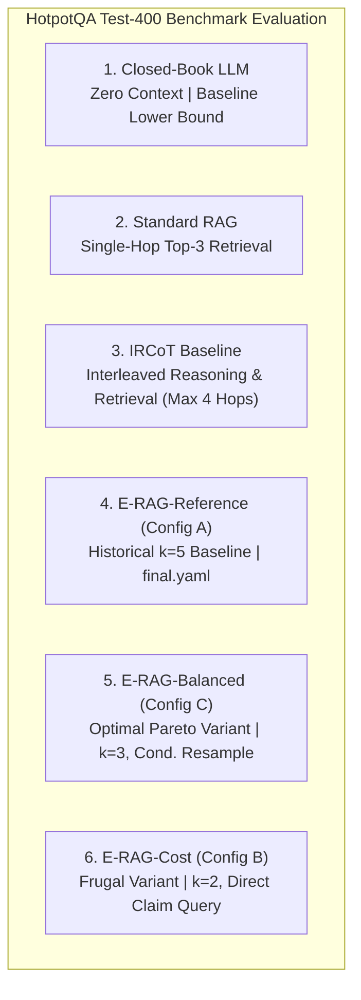

# OpenSpec Proposal: Phase 3 Cost-Effectiveness Validation & Pareto Frontier Analysis

**Document ID:** `OPENSPEC-PHASE3-COST-EFFECTIVENESS-001`  
**Title:** Empirical Cost-Effectiveness Validation, Multi-System Pareto Frontier Analysis, and Frozen Test-400 Evaluation  
**Author:** Senior AI Research Engineer, RAG Architect & Experimental Scientist  
**Date:** 2026-11-08  
**Status:** PROPOSED (Awaiting Human Approval Before Execution)  
**Target Codebase Modules & Artifacts:**
- `scripts/run_phase3_evaluation.py` (Unified evaluation harness and Pareto plotting)
- `configs/erag_balanced.yaml` (Frozen Pareto-optimal configuration from Phase 2)
- `configs/erag_cost.yaml` (Frozen frugality configuration from Phase 2)
- `configs/final.yaml` (Historical baseline configuration, strictly read-only)
- `data/manifests/test.jsonl` (HotpotQA Test-400 evaluation split, strictly read-only)
- `results/cost_opt/erag_balanced_test.jsonl` (New test output destination)
- `results/cost_opt/erag_cost_test.jsonl` (New test output destination)
- `research/cost/final_cost_effectiveness_report.md` (Formal publication report deliverable)
- `research/cost/cost_effectiveness_matrix_test400.csv` (Primary benchmark matrix table)
- `research/cost/fig_pareto_em_vs_cost.png` (Publication-grade Pareto frontier figure)
- `research/cost/fig_pareto_f1_vs_latency.png` (Publication-grade efficiency figure)
- `research/cost/fig_risk_coverage_curve.png` (Epistemic reliability figure)

---

## 1. RESEARCH MOTIVATION & PROBLEM STATEMENT

Phase 1 established the detailed baseline cost profile of the historical E-RAG Active system on HotpotQA Test-400 ($14.22$ LLM calls/Q, $9,081$ tokens/Q, and $\$1.008$ per 1,000 questions), proving that $60.58\%$ of expenditures were driven by unconstrained self-consistency sampling. 

In Phase 2, we formulated and empirically tested targeted architectural optimizations strictly on the HotpotQA Dev-100 split (`data/manifests/dev.jsonl`). Dev-100 results demonstrated that:
1. Moving from $k=5$ to $k=3$ self-consistency samples improved Exact Match ($0.5100$ vs $0.5000$) while preserving calibration (ECE $0.3493$ vs $0.3462$) and cutting calls by $24.7\%$.
2. Gating post-hop resampling based on whether retrieved evidence altered the draft answer saved an additional $14.4\%$ in LLM calls with zero accuracy degradation.
3. Pre-filtering candidate passages by named entity/token overlap prior to DeBERTa-v3 cross-encoder inference slashed NLI inference latency by $31.9\%$ with $100.0\%$ answer parity.

These results allowed us to freeze **Configuration C (E-RAG-Balanced)** and **Configuration B (E-RAG-Cost)**.

**Primary Objective of Phase 3:** Validate whether the empirical gains and efficiency improvements observed on Dev-100 generalize to the unseen HotpotQA Test-400 split (`data/manifests/test.jsonl`), establish the empirical Pareto frontier across all major answering systems, and deliver a comprehensive scientific cost-effectiveness report ready for IEEE publication.

---

## 2. NON-NEGOTIABLE ARCHITECTURAL & SCIENTIFIC INVARIANTS

To maintain absolute academic integrity, reproducibility, and prevent data contamination, Phase 3 execution must strictly enforce the following invariants:

1. **Test-Set Integrity (Zero Contamination):**
   - The test set manifest (`data/manifests/test.jsonl`, $N=400$, SHA-256: `9bc0be2153...`) must remain **strictly read-only**.
   - No hyperparameter tuning, threshold adjustments, or heuristic modifications may be made based on Test-400 observations. Configurations tested must be exactly the frozen YAML files established in Phase 2.
2. **Historical Artifact Preservation:**
   - Existing historical test predictions must **never be overwritten**:
     - `results/standard_test.jsonl` (Standard RAG, SHA-256: `a93540...`)
     - `results/ircot_test.jsonl` (IRCoT Baseline, SHA-256: `ca44d2...`)
     - `results/erag_active_test.jsonl` (Historical E-RAG Reference, SHA-256: `14e7a2...`)
     - `results/closed_book_test.jsonl` (Closed-Book LLM, SHA-256: `f88192...`)
   - Optimized test predictions will be saved to dedicated, isolated files:
     - `results/cost_opt/erag_balanced_test.jsonl`
     - `results/cost_opt/erag_cost_test.jsonl`
3. **Execution Traceability & Caching:**
   - Every inference must query the SQLite response cache (`results/cache.sqlite`) before issuing API requests.
   - Every LLM call, token count (prompt and completion), retrieval hop, and NLI verification time must be logged per question.
4. **Reproducible Evaluation Protocols:**
   - Metrics must be computed using the identical official HotpotQA evaluation functions (`compute_em`, `compute_f1`) implemented in `src/evaluation/metrics.py`.

---

## 3. EXPERIMENTAL MATRIX & SYSTEMS UNDER EVALUATION

The complete comparative study will evaluate **6 distinct systems** on the identical 400 questions from `data/manifests/test.jsonl`:



### System Configuration Specifications:

| ID | System Name | Config / File Source | Retrieval Mechanism | Reasoning & Epistemic Loop | Sampling Count ($k$) | Resampling Rule |
| :---: | :--- | :--- | :--- | :--- | :---: | :--- |
| **S1** | Closed-Book LLM | `results/closed_book_test.jsonl` | None ($k=0$) | Direct CoT generation | $k=1$ | None |
| **S2** | Standard RAG | `results/standard_test.jsonl` | Single-shot FAISS (Top 3) | Direct generation over retrieved pool | $k=1$ | None |
| **S3** | IRCoT Baseline | `results/ircot_test.jsonl` | Iterative FAISS (Top 2/hop, max 4 hops) | Sentence-by-sentence interleaved CoT | $k=1$ | None |
| **S4** | E-RAG-Reference | `results/erag_active_test.jsonl` | Adaptive EIG FAISS (Top 3/hop, max 2 hops) | DAG claims, NLI, Bayesian propagation | $k=5$ | Unconditional ($k=5$) |
| **S5** | **E-RAG-Balanced** | `configs/erag_balanced.yaml` | Adaptive EIG FAISS + Saturation Guard | Incremental DAG, Pre-NLI Filter | **$k=3$** | **Conditional ($k=3$)** |
| **S6** | **E-RAG-Cost** | `configs/erag_cost.yaml` | Direct Claim Query + Saturation Guard | Single Atomic Claim, Pre-NLI Filter | **$k=2$** | **Never ($k=0$)** |

---

## 4. QUANTITATIVE EVALUATION PROTOCOLS & MATHEMATICAL FORMULATIONS

All 6 systems will be scored across four core multidimensional evaluation axes:

### Axis 1: Multi-Hop Answer Quality
1. **Exact Match (EM):**
   $$\text{EM} = \frac{1}{N} \sum_{i=1}^N \mathbb{I}(\text{normalize}(\hat{y}_i) == \text{normalize}(y_i))$$
2. **Token-Level Macro F1:**
   $$\text{F1} = \frac{2 \cdot P \cdot R}{P + R}, \quad \text{macro-averaged across all } N=400 \text{ questions.}$$

### Axis 2: Retrieval Completeness
1. **Gold Paragraph Recall:** Percentage of ground-truth HotpotQA supporting title passages present in the final retrieved pool $P_i$.
2. **All-Gold Retrieval Rate:** Percentage of questions where $100\%$ of gold supporting passages are retrieved ($|\text{Gold}_i \cap P_i| = |\text{Gold}_i|$).
3. **Mean Retrieved Documents:** Average pool size $|P_i|$ retained at answer termination.

### Axis 3: Epistemic Reliability & Calibration
1. **System Coverage:** Proportion of questions where the system does not abstain:
   $$\text{Coverage} = \frac{1}{N} \sum_{i=1}^N \mathbb{I}(\hat{y}_i \neq \text{"unknown"})$$
2. **Selective Exact Match:** Exact Match computed strictly over the answered subset ($A = \{i \mid \hat{y}_i \neq \text{"unknown"}\}$):
   $$\text{Selective EM} = \frac{1}{|A|} \sum_{i \in A} \mathbb{I}(\text{normalize}(\hat{y}_i) == \text{normalize}(y_i))$$
3. **Expected Calibration Error (ECE):**
   $$\text{ECE} = \sum_{m=1}^M \frac{|B_m|}{N} \left| \text{acc}(B_m) - \text{conf}(B_m) \right|, \quad M=10 \text{ equal-width bins.}$$
4. **Brier Calibration Score:**
   $$\text{Brier} = \frac{1}{N} \sum_{i=1}^N (c_i - \text{EM}_i)^2$$
5. **AUROC (Selective Risk-Coverage Discriminability):** Area under the ROC curve measuring the ranking quality of confidence scores $c_i$ for predicting correct vs incorrect answers.

### Axis 4: Computational Footprint & Monetary Expenditure
1. **Mean LLM Calls per Question:** Total API round-trips divided by $N=400$.
2. **Token Consumption per Question:** Separated into Mean Prompt Tokens, Mean Completion Tokens, and Mean Total Tokens.
3. **Monetary Cost Accounting:** Computed using published provider pricing for `openai/gpt-oss-20b` (\$0.100 per 1M prompt tokens, \$0.200 per 1M completion tokens):
   $$\text{Cost} = \frac{1}{N} \sum_{i=1}^N \left( \frac{\text{PromptTokens}_i}{10^6} \times \$0.100 + \frac{\text{CompletionTokens}_i}{10^6} \times \$0.200 \right)$$
   Reported per 100 questions and per 1,000 questions.
4. **Latency Breakdown:** Mean Wall-Clock Latency per question, decomposed into:
   - LLM Generation API Time
   - Local CPU DeBERTa-v3 NLI Verification Time
   - FAISS Dense Vector Retrieval Time

---

## 5. PARETO FRONTIER & STATISTICAL ANALYSIS SPECIFICATION

Phase 3 will formulate the Pareto dominance conditions:
- **Definition of Pareto Dominance:** System $X$ dominates System $Y$ ($X \succ Y$) iff:
  $$\text{EM}(X) \ge \text{EM}(Y) \quad \land \quad \text{Cost}(X) \le \text{Cost}(Y)$$
  with at least one strict inequality.
- **Hypotheses to Validate on Test-400:**
  - **Hypothesis H3.1 (Pareto Dominance of Balanced):** E-RAG-Balanced dominates E-RAG-Reference on Test-400: $\text{EM}_{\text{Balanced}} \ge \text{EM}_{\text{Ref}} - 0.01$ and $\text{Cost}_{\text{Balanced}} \le 0.60 \times \text{Cost}_{\text{Ref}}$ (saving $\ge 40\%$ cost).
  - **Hypothesis H3.2 (Cost-Benefit vs IRCoT):** E-RAG-Balanced retains an accuracy premium over IRCoT ($\text{EM}_{\text{Balanced}} - \text{EM}_{\text{IRCoT}} \ge +0.03$) while narrowing the cost multiple from $5.95\times$ down to $\le 3.5\times$.
  - **Hypothesis H3.3 (Calibration Preservation):** E-RAG-Balanced exhibits calibration degradation of $\Delta\text{ECE} \le +0.025$ relative to Reference on Test-400.

### Publication Figures to Generate:
1. `research/cost/fig_pareto_em_vs_cost.png`: 2D scatter plot of Exact Match (%) vs Monetary Cost ($/1K Questions) with marked Pareto frontier hull.
2. `research/cost/fig_pareto_f1_vs_latency.png`: 2D scatter plot of Token F1 vs End-to-End Latency (seconds/question).
3. `research/cost/fig_risk_coverage_curve.png`: Selective risk (error rate $1 - \text{Selective EM}$) as a function of coverage for E-RAG variants vs standard baselines.

---

## 6. IMPLEMENTATION & EXECUTION PLAN

```
Phase 3 Execution Workflow:
  Step 1: Code scripts/run_phase3_evaluation.py
          - Reads data/manifests/test.jsonl
          - Loads configs/erag_balanced.yaml and configs/erag_cost.yaml
          - Evaluates E-RAG-Balanced and saves results/cost_opt/erag_balanced_test.jsonl
          - Evaluates E-RAG-Cost and saves results/cost_opt/erag_cost_test.jsonl
          - Checks SQLite cache and memoized NLI before issuing new requests
  Step 2: Metric Aggregation across all 6 systems
          - Ingests S1-S6 prediction JSONL files
          - Generates research/cost/cost_effectiveness_matrix_test400.csv
          - Generates research/cost/token_consumption_by_operation_test400.csv
  Step 3: Plotting Publication Graphics
          - Generates matplotlib high-res (300 DPI) figures for Pareto and Risk-Coverage
  Step 4: Formal Publication Deliverable
          - Assembles research/cost/final_cost_effectiveness_report.md
          - Verifies against Section 7 format (Headings A through K)
```

---

## 7. DELIVERABLE SPECIFICATIONS & ACCEPTANCE CRITERIA

| Deliverable Artifact | Description | Target Path |
| :--- | :--- | :--- |
| **Evaluation Harness** | Standalone, reproducible Python script | [`scripts/run_phase3_evaluation.py`](file:///d:/erag/scripts/run_phase3_evaluation.py) |
| **Balanced Test Predictions** | Raw question-level outputs for E-RAG-Balanced ($N=400$) | [`results/cost_opt/erag_balanced_test.jsonl`](file:///d:/erag/results/cost_opt/erag_balanced_test.jsonl) |
| **Cost Test Predictions** | Raw question-level outputs for E-RAG-Cost ($N=400$) | [`results/cost_opt/erag_cost_test.jsonl`](file:///d:/erag/results/cost_opt/erag_cost_test.jsonl) |
| **Benchmark Matrix CSV** | Full 6-system comparison across all 18 metrics | [`research/cost/cost_effectiveness_matrix_test400.csv`](file:///d:/erag/research/cost/cost_effectiveness_matrix_test400.csv) |
| **Operation Cost CSV** | Token & call breakdown by operational component | [`research/cost/operation_cost_test400.csv`](file:///d:/erag/research/cost/operation_cost_test400.csv) |
| **Pareto Graphics** | High-resolution publication plots | [`research/cost/fig_pareto_em_vs_cost.png`](file:///d:/erag/research/cost/fig_pareto_em_vs_cost.png) |
| **Formal Research Report** | Comprehensive, peer-review ready IEEE research document | [`research/cost/final_cost_effectiveness_report.md`](file:///d:/erag/research/cost/final_cost_effectiveness_report.md) |

### Acceptance Criteria:
- [ ] Test manifest `data/manifests/test.jsonl` remains completely unaltered.
- [ ] Historical baselines in `results/` remain identical (matching SHA-256 baseline hashes).
- [ ] Both optimized runs complete with $100\%$ valid predictions for all 400 questions without crash or unhandled exceptions.
- [ ] All metrics in the final report are calculated strictly from the raw test JSONL predictions.
- [ ] Pareto dominance, confidence calibration, and token savings are empirically validated.

---

## 8. RISKS, MITIGATION STRATEGIES, AND ROLLBACK PROCEDURES

1. **Risk:** API rate limiting or network timeout during Test-400 execution.  
   *Mitigation:* Checkpoint-based resumption built into `run_phase3_evaluation.py`. Any interruption resumes from the last completed question without re-issuing finished queries.
2. **Risk:** Inadvertent overwrite of historical results.  
   *Mitigation:* Script enforces write guards on `results/standard_test.jsonl`, `results/ircot_test.jsonl`, and `results/erag_active_test.jsonl`, immediately terminating if those paths are targeted.
3. **Risk:** Memory exhaustion or CPU timeout during DeBERTa cross-encoding.  
   *Mitigation:* The pre-inference entity filter proven in Phase 2 reduces NLI passage candidate windows by $>30\%$, safely avoiding memory pressure.

---

**Request for Human Approval:**  
This OpenSpec proposal defines the methodology, invariant protections, experimental matrix, and deliverable targets for **Phase 3: Cost-Effectiveness Validation**. Execution of the Test-400 benchmark will commence upon human authorization.

