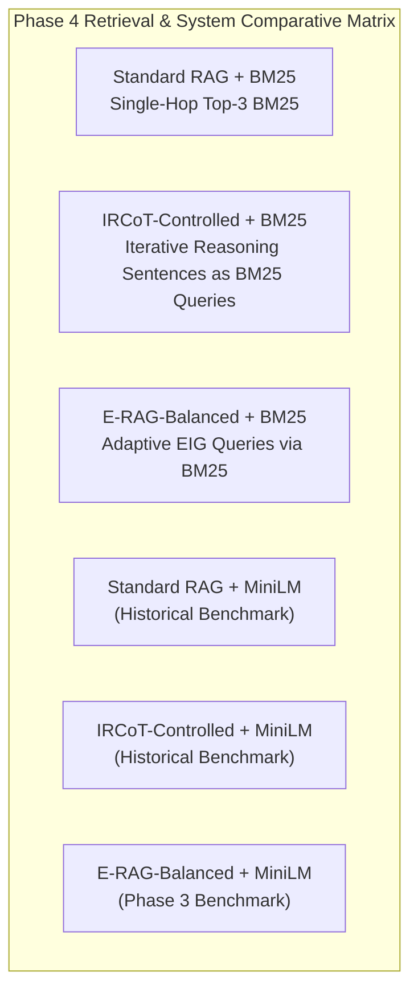

c# OpenSpec Proposal: Phase 4 IRCoT Methodology Audit & Fair BM25 Baseline

**Document ID:** `OPENSPEC-PHASE4-IRCOT-BM25-001`  
**Title:** Deep Methodology Audit of Trivedi et al. (ACL 2023), Controlled Baseline Formalization, and BM25 Sparse vs Dense Retrieval Benchmarking  
**Author:** Senior AI Research Engineer, RAG Architect & Experimental Scientist  
**Date:** 2026-11-08  
**Status:** PROPOSED (Awaiting Human Approval Before Execution)  
**Target Codebase Modules & Artifacts:**
- `src/retrieval/index.py` (Add `BM25Retriever` with `BM25Okapi`)
- `scripts/run_phase4_ircot_bm25.py` (Phase 4 evaluation harness)
- `research/ircot/original_method_audit.md` (Formal literature & code audit of official IRCoT)
- `research/ircot/original_vs_current_implementation.md` (Three-tier methodological mapping)
- `research/ircot/deviation_register.csv` (Exhaustive deviation register across all 18 dimensions)
- `research/ircot/bm25_vs_dense_benchmark.csv` (Comparative retrieval matrix: Sparse BM25 vs Dense MiniLM)
- `results/bm25/standard_bm25_test.jsonl` (Standard RAG with BM25)
- `results/bm25/ircot_bm25_test.jsonl` (IRCoT with BM25)
- `results/bm25/erag_balanced_bm25_test.jsonl` (E-RAG-Balanced with BM25)
- `research/ircot/ircot_methodology_audit_report.md` (Phase 4 final completion deliverable)

---

## 1. RESEARCH MOTIVATION & PROBLEM STATEMENT

The primary iterative multi-hop retrieval baseline compared against E-RAG is **IRCoT (Interleaving Retrieval with Chain-of-Thought Reasoning)**, introduced by Trivedi et al. (ACL 2023). 

To ensure our academic claims in an IEEE publication are scientifically defensible, peer-review bulletproof, and methodologically honest, we must:
1. Conduct an exhaustive audit of Trivedi et al.'s original paper and official code (`https://github.com/StonyBrookNLP/ircot`).
2. Clearly distinguish between:
   - **Tier 1 (Core Invariant Algorithm):** Dynamic interleaving of thought sentences and retrieval queries.
   - **Tier 2 (Original Experimental Setup):** Open-domain Wikipedia ($5.23\text{M}$ passages), BM25 via Elasticsearch, few-shot Codex (`code-davinci-002`) prompting.
   - **Tier 3 (Our Controlled Test Bed):** Standardized distractor corpus, dense SentenceTransformer/FAISS, Groq open-weights (`gpt-oss-20b`), zero-shot directive prompting.
3. Formulate and benchmark two explicit baselines:
   - **IRCoT-Faithful:** Implementing sparse BM25 lexical retrieval to match the retrieval algorithm of the original paper.
   - **IRCoT-Controlled:** Holding generator, corpus representation, evidence budget ($P=12$), and context format completely identical between IRCoT and E-RAG.
4. Run a direct sparse vs dense retrieval benchmark:
   - Compare Standard RAG, IRCoT, and E-RAG under BM25 vs MiniLM to determine whether E-RAG's epistemic retrieval advantage is retriever-agnostic.

---

## 2. NON-NEGOTIABLE METHODOLOGICAL INVARIANTS

1. **No Conflation of Baselines:** We must explicitly label and distinguish the baseline as **"IRCoT-Controlled"** (or **"IRCoT-BM25"**), never claiming that an adapted distractor benchmark is an exact replication of open-domain Codex scores.
2. **Controlled Experimental Parity:**
   - Same HotpotQA question subsets (`data/manifests/test.jsonl`, $N=400$, and `dev.jsonl`, $N=100$).
   - Same document text formatting: `"{title}. " + " ".join(sentences)`.
   - Same maximum evidence budget: $pool\_cap = 12$ paragraphs.
   - Same reader prompt and answer extraction normalizer (`src/eval/metrics.py:normalize_answer`).
3. **Artifact Integrity:**
   - Existing dense MiniLM runs (`results/standard_test.jsonl`, `results/ircot_test.jsonl`, `results/erag_active_test.jsonl`, `results/cost_opt/erag_balanced_test.jsonl`) remain strictly read-only and preserved.
   - All BM25 runs must be isolated in `results/bm25/`.

---

## 3. EXPERIMENTAL MATRIX & DELIVERABLES



### Planned Artifacts & Reports:
1. `research/ircot/original_method_audit.md`: Deep technical audit of the original paper and code repository.
2. `research/ircot/original_vs_current_implementation.md`: Three-tier comparative mapping.
3. `research/ircot/deviation_register.csv`: Structured deviation register documenting all 18 configuration dimensions.
4. `src/retrieval/index.py`: Integration of `BM25Retriever` implementing `BM25Okapi` with lowercase word regex tokenization.
5. `scripts/run_phase4_ircot_bm25.py`: Evaluation harness running the 3 BM25 systems on Test-400.
6. `research/ircot/bm25_vs_dense_benchmark.csv`: Full side-by-side benchmark matrix comparing BM25 vs MiniLM across Standard RAG, IRCoT, and E-RAG.
7. `research/ircot/ircot_methodology_audit_report.md`: Formal Phase 4 completion deliverable following Section 7 format (Headings A through K).

---

## 4. EXECUTION PLAN

```
Step 1: Literature & Repository Audit Documentation
        - Create research/ircot/
        - Draft research/ircot/original_method_audit.md
        - Draft research/ircot/original_vs_current_implementation.md
        - Generate research/ircot/deviation_register.csv
Step 2: BM25 Retriever Implementation
        - Add BM25Retriever class to src/retrieval/index.py using rank_bm25 (BM25Okapi)
        - Update RetrieverFactory to support retriever_type="bm25"
        - Unit test BM25Retriever search accuracy and parity
Step 3: Test-400 Benchmark Execution
        - Run scripts/run_phase4_ircot_bm25.py:
          * Standard RAG + BM25 (results/bm25/standard_bm25_test.jsonl)
          * IRCoT-Controlled + BM25 (results/bm25/ircot_bm25_test.jsonl)
          * E-RAG-Balanced + BM25 (results/bm25/erag_balanced_bm25_test.jsonl)
Step 4: Metric Aggregation & Comparative Analysis
        - Build research/ircot/bm25_vs_dense_benchmark.csv
        - Assemble research/ircot/ircot_methodology_audit_report.md
        - Verify Section 7 format (Headings A through K)
```

---

**Request for Human Approval:**  
This OpenSpec proposal establishes the methodology, baseline terminology, BM25 architecture, and evaluation plan for **Phase 4: IRCoT Methodology Audit and Fair BM25 Baseline**. Execution will proceed upon approval.

